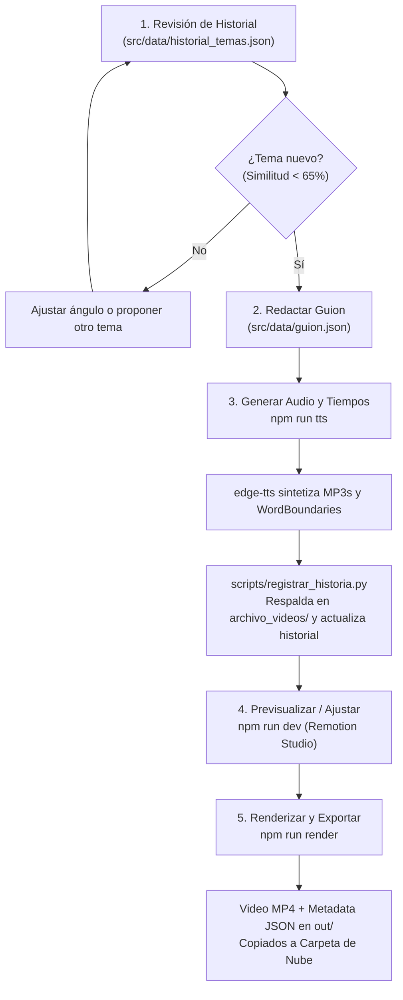

# AutoPNGTuber 🎬⚡

> **Motor automatizado de producción y renderizado de videos verticales (YouTube Shorts, TikTok, Instagram Reels) en formato 9:16 (1080×1920 a 30 FPS), con animación procedural, síntesis de voz neuronal y subtítulos karaoke sincronizados al milisegundo.**

Desarrollado sobre **[Remotion](https://remotion.dev/)**, **React 18**, **TypeScript**, **Tailwind CSS** y **Python (Chatterbox Multilingual TTS + Faster-Whisper + Mutagen)**, AutoPNGTuber transforma un guion estructurado en JSON en una pieza audiovisual animada, dinámica y con estilo neo-brutalista lista para su publicación en redes sociales.

---

## 📌 ¿Qué hace el proyecto?

AutoPNGTuber elimina la necesidad de editar videos manualmente para canales de divulgación científica, hechos curiosos y estilo *"¿Sabías que...?"*:

1. **Interpreta guiones narrativos estructurados** divididos en escenas con diálogos, emociones, encuadres de cámara y utilería.
2. **Genera voces neuronales realistas** mediante síntesis de voz en la nube con extracción de eventos fonéticos (*word boundaries*).
3. **Sincroniza y dimensiona el video automáticamente**: calcula el tiempo exacto que dura cada escena a partir del audio generado, eliminando desajustes temporales.
4. **Anima personajes procedimentales y actores secundarios**: sincronización labial (*lip-sync* reactivo al audio), parpadeo automático de ojos, micro-movimientos de respiración, cambios de expresión y secuencias de acción física (caminar, retroceder con miedo, tropezar, interactuar).
5. **Dirige la cinematografía del encuadre**: paneos, transiciones (*whip*, zoom, flash), efectos de sacudida sísmica (*shake*), empuje (*punch*) y zooms lentos (*drift*), manteniendo los subtítulos y el HUD siempre legibles e inmóviles en una capa desacoplada.
6. **Produce subtítulos estilo karaoke dinámicos**: bloques de texto de alto impacto que resaltan la palabra activa en amarillo neo-brutalista (`#FFE600`) y agrandan palabras clave o cifras numéricas.
7. **Empaqueta y exporta para distribución**: renderiza el video en MP4 de alta tasa de bits, genera un archivo de metadatos `.json` con título optimizado para SEO, descripción, hashtags virales y copia el resultado final a una unidad local o de nube para su publicación inmediata.

---

## 🚀 ¿De qué es capaz? (Características Clave)

### 🎭 1. Motor de Personajes y Poses Modulares (PNGTuber / Stickman)
- **Catálogo de más de 350 recursos visuales validados**: 68 poses corporales completas, 24 expresiones faciales vectoriales y más de 200 elementos de utilería (ciencia, tecnología, historia, festividades).
- **Animación Procedimental Viva**:
  - **Lip-Sync Automático**: La boca del personaje se abre y modula en tiempo real según el volumen y la presencia de fonemas del audio de cada escena.
  - **Parpadeo Natural**: Ciclos aleatorios de parpadeo que evitan la sensación de personajes inertes.
  - **Micro-Balanceo**: Física de balanceo de peso corporal y bamboleo comunicativo que impide que el personaje quede congelado en pantalla.
- **Soporte Híbrido**: Puede usar el Stickman SVG procedural nativo o reemplazarlo por ilustraciones/avatares personalizados en formato PNG.

### 🎬 2. Narrativa Multi-Personaje y Acciones Físicas
- Permite orquestar **múltiples personajes en una misma escena** (narrador, sonámbulo, astronauta, médico, amigo) con capas de profundidad (`capaZ`), escalas independientes y orientaciones (`derecha` o `izquierda`).
- **Secuencias de Movimiento con Easing**:
  - `caminar_hacia`: traslación espacial con ciclo rítmico de paso e inclinación corporal (*bobbing*).
  - `sorpresa_y_retroceso` / `despertar_asustado`: estallido de sobresalto, salto hacia atrás con temblor de pánico y postura desorientada.
  - `tropezar_y_reaccionar`: pérdida de equilibrio y recuperación dramática o cómica.
  - `acercarse_y_tocar`: aproximación con extensión de brazo hacia un objeto de interés.
  - **Acciones personalizadas paso a paso**: interpolación de curvas (`suave`, `anticipacion`, `rebote`, `impacto`) y procedimentales de vibración o retroceso.

### 📦 3. Sistema Universal de Props e Ilustraciones (Props Engine)
- **Props Vectoriales Ilustrados**: Ilustraciones con volumen y color (`black_hole`, `kidneys`, `salt_crystal`, `spaceship`, etc.) diseñadas para conceptos científicos complejos.
- **Integración instantánea de Lucide (+1,400 iconos al vuelo)**: Si una escena requiere un objeto no catalogado, basta con invocar `"lucide:Dna"`, `"lucide:Atom"`, `"lucide:Telescope"`, etc. El motor lo dibuja automáticamente como un sticker neo-brutalista circular con borde negro de 5px.
- **SVG Inline Personalizado**: Permite inyectar vectores directos con el prefijo `"svg:<path ...>"`.
- **Física de Objetos en Escenario**: Objetos con animaciones autónomas de `caer`, `flotar`, `vibrar` o `pulso`.

### 🎥 4. Rig de Cámara Cinemático y Capa HUD Desacoplada
- **Desacoplamiento Cámara / Interfaz**: La cámara mueve, acerca y sacude únicamente el escenario, los personajes y los objetos. Los subtítulos y los títulos superiores (`AnimatedIcon`) permanecen fijos y perfectamente legibles en pantalla en todo momento.
- **Encuadre Dinámico**: Alternancia entre planos generales (`plano_general`), planos medios, escenarios ilustrados (`habitacion_noche`, `laboratorio`) y primeros planos (`primer_plano` con zoom al 142% y viñeta focal).
- **Efectos Cinemáticos**: `shake` (trauma y sacudidas sísmicas), `punch` (golpe de zoom rápido en impactos) y `drift` (acercamiento continuo para sostener la tensión).
- **Elementos Narrativos Reactivos**: Gráficos como `giant_waves` (olas marinas), `speed_lines` (líneas de velocidad cósmica), `shockwave_burst` (ondas de choque), `danger_vignette` (pulso perimetral rojo) y velocímetros en pantalla.

### 🎙️ 5. TTS Neuronal y Subtítulos Karaoke al Milisegundo
- Integración con `edge-tts` para generar voces en español neutro de alta fidelidad.
- Detección de marcas de tiempo fonéticas palabra por palabra.
- Subtítulos neo-brutalistas (`WordSubtitles`) sin solapamiento ni desbordamiento de pantalla: bloques de 2 a 3 palabras en mayúsculas, fondo contrastante, resaltado en amarillo chillón de la palabra activa y énfasis tipográfico agrandado en cifras clave.
- Mezcla de efectos de sonido (SFX) sincronizados a las transiciones y cortes (`sfx_whoosh`, `sfx_impact`, `sfx_dramatic_hit`).

### 🧠 6. Registro Histórico y Detector de Duplicados
- **Prevención de plagio o repetición de temas**: Analiza el archivo histórico `src/data/historial_temas.json` usando `difflib.SequenceMatcher`. Si un guion nuevo supera el 65% de similitud temática o de gancho con uno anterior, emite una alerta temprana.
- **Respaldo Automático**: Cada historia aprobada y generada se almacena en `archivo_videos/` con su fecha y slug para conservar una bitácora inmutable de todo el contenido del canal.

### 📤 7. Pipeline de Renderizado y Automatización de Metadatos
- **Nombres de archivo inteligentes**: Asigna nombres limpios en formato slug al `.mp4` según el tema o título visual de la historia (ej. `2026-10-21_el_abismo_oceanico.mp4`).
- **Limpieza de Caché**: Purga automáticamente archivos de renderizado antiguos (>48 horas) para optimizar el almacenamiento en disco.
- **Metadata para Publicación**: Genera un archivo `.json` complementario con título SEO, descripción, llamada a la acción (CTA), hashtags optimizados (`#Shorts`, `#Ciencia`, etc.), duración y métricas del video.
- **Sincronización a la nube**: Envía automáticamente el video y su metadata al directorio de Google Drive configurado para su subida programada.

---

## 🔄 Flujo de Producción (Pipeline)



---

## 📂 Estructura del Proyecto

```text
AutoPNGTuber/
├── archivo_videos/             # Histórico de guiones respaldados ({fecha}_{slug}.json)
├── docs/                       # Licencias, checklist de publicación y seguimiento
│   ├── CHECKLIST_PUBLICACION.md # Protocolo de 2 minutos antes de publicar y experimento A/B
│   ├── LICENCIAS.md            # Registro de voces, música, SFX y políticas de monetización
│   └── SEGUIMIENTO.csv         # Registro de métricas a 48h
├── out/                        # Videos renderizados organizados
│   ├── pendientes/             # Videos y metadatos listos para publicar
│   ├── publicados/             # Videos ya subidos
│   └── pruebas/                # Renders de test y archivos temporales
├── public/
│   ├── audios/                 # Audios generados por escena (escena_{id}.mp3) y caché TTS
│   ├── bgm/                    # Pistas musicales de fondo (bgm.mp3)
│   ├── poses/                  # Catálogo de 357 SVGs del stickman + contact_sheet.html
│   └── sfx/                    # Efectos de sonido (whooshes, impactos, hits dramáticos)
├── scripts/
│   ├── exportar_metadata.js    # Generador de metadatos JSON para redes sociales
│   ├── generar_biblioteca_poses.mjs # Compilador del catálogo de poses y hoja de contacto
│   ├── generar_voz.py          # Generador TTS (Chatterbox + Faster-Whisper + Mutagen)
│   ├── legacy/                 # Scripts archivados de un solo uso
│   ├── qa_video.js             # Chequeo QA automático con ffprobe y ffmpeg
│   ├── registrar_historia.py   # Auditor de similitud, registro en historial y respaldo
│   ├── render_short.js         # Orquestador de renderizado con pre-validación y post-QA
│   └── validar_guion.js        # Validador de guion con esquema Zod y lint visual
├── src/
│   ├── components/
│   │   ├── AnimatedIcon.tsx    # Rótulo e icono neo-brutalista animado superior
│   │   ├── CameraRig.tsx       # Sistema de cámara cinemática, trauma shake y zooms
│   │   ├── NarrativeElements.tsx # Gráficos reactivos (olas, líneas de velocidad, viñetas)
│   │   ├── NarrativeStage.tsx  # Escenarios temáticos (laboratorio, noche, etc.)
│   │   ├── Scene.tsx           # Coordinador principal de capas y actores por escena
│   │   ├── SceneObject.tsx     # Renderizador de props y objetos con física en escena
│   │   ├── Stickman.tsx        # Motor del personaje SVG con lip-sync y parpadeo
│   │   └── WordSubtitles.tsx   # Subtítulos dinámicos palabra por palabra estilo karaoke
│   ├── data/
│   │   ├── guion.json          # Guion activo en producción
│   │   ├── historial_temas.json # Base de datos de historias previas y ganchos
│   │   └── poses.json          # Catálogo completo de poses, props y expresiones
│   ├── stickman/
│   │   ├── actionSequences.ts  # Físicas, interpolaciones y secuencias de movimiento
│   │   ├── bodyPoses.ts        # Definición de 68 poses corporales y anclajes
│   │   ├── catalog.ts          # Motor de búsqueda y filtrado de recursos
│   │   ├── composites.ts       # Ensamblador vectorial de poses compuestas
│   │   ├── expressions.ts      # 24 expresiones faciales vectoriales
│   │   ├── festiveLibrary.ts   # 123 props y poses festivas y estacionales
│   │   └── propsLibrary.ts     # Props generales vectoriales de ciencia, objetos e historia
│   ├── Root.tsx                # Composición raíz de Remotion y cálculo dinámico de duración
│   └── types.ts                # Interfaces y contratos TypeScript del sistema
├── AGENTS.md                   # Manual de arquitectura y directrices para agentes IA
├── AGENT_RULES.md             # Reglas estrictas de calidad, duración y animación
├── package.json
└── remotion.config.ts          # Configuración de renderizado de Remotion
```

---

## 🛠️ Requisitos e Instalación

### Prerrequisitos
- **Node.js**: v18.0.0 o superior.
- **Python**: v3.9 o superior.
- **FFmpeg**: Requerido por Remotion para la composición de video y audio.

### Instalación

1. Clonar el repositorio o abrir la carpeta del proyecto:
   ```bash
   cd AutoPNGTuber
   ```

2. Instalar dependencias de Node.js:
   ```bash
   npm install
   ```

3. Instalar librerías de Python necesarias para la generación de voz:
   ```bash
   pip install edge-tts mutagen
   ```

---

## 💻 Guía de Comandos

| Comando | Descripción |
| :--- | :--- |
| `npm run validar` | Valida el esquema zod de `src/data/guion.json` (poses, props, escenarios, duraciones, tiempos) y avisa de ritmo visual. |
| `npm run tts` | Sintetiza los audios con voz clonada local (Chatterbox), alinea timestamps fonéticos con faster-whisper y archiva el historial. |
| `npm run dev` | Inicia el entorno de desarrollo visual en vivo en **Remotion Studio** (`http://localhost:3000`). |
| `npm run qa` | Chequea el MP4 con ffprobe/ffmpeg (duración, resolución 1080×1920, 30fps, loudness ≈ -14 LUFS, silencios y tamaño). |
| `npm run render` | Valida el guion, renderiza el video con Remotion (CRF 22), ejecuta el QA, exporta metadata `.json` y copia a `DESTINO_DIR`. |
| `npm run render:all` | Atajo que ejecuta `npm run tts` seguido de `npm run render`. |
| `npm run metadata` | Genera o actualiza el archivo de metadatos `.json` para YouTube/TikTok sin necesidad de renderizar el video. |
| `npm run poses:build` | Recompila los SVGs modulares del Stickman, actualiza `src/data/poses.json` y genera la hoja de contacto visual. |
| `npm run historial` | Ejecuta de forma aislada la verificación de similitud y el respaldo del guion actual en el historial. |

---

## 📚 Documentación de Publicación y Operación

- **[docs/LICENCIAS.md](docs/LICENCIAS.md)**: Inventario de origen de voces, música, SFX y políticas de contenido sintético / inauténtico de YouTube y TikTok.
- **[docs/CHECKLIST_PUBLICACION.md](docs/CHECKLIST_PUBLICACION.md)**: Protocolo de revisión de 2 minutos antes de publicar y guía del experimento A/B de duración.
- **[docs/SEGUIMIENTO.csv](docs/SEGUIMIENTO.csv)**: Hoja de registro de métricas a 48h (retención, vistas, suscriptores, grupo A/B).

---

## 📝 Ejemplo de Guion (`src/data/guion.json`)

El archivo de entrada puede configurarse con personajes individuales o con el sistema de dirección avanzada:

```json
{
  "meta": {
    "id": "misterio_abismo_oceanico",
    "slug": "el_abismo_oceanico",
    "temaResumen": "¿Qué le sucede a tu cuerpo si desciendes a la Fosa de las Marianas?"
  },
  "escenas": [
    {
      "id": 1,
      "texto": "¿Sabías qué pasaría si cayeras al fondo de la Fosa de las Marianas?",
      "icono": "Compass",
      "colorIcono": "#0EA5E9",
      "tituloVisual": "EL ABISMO OCEÁNICO",
      "composicionVisual": "primer_plano",
      "layout": "narrativo",
      "elementosNarrativos": ["giant_waves", "danger_vignette"],
      "efectosCamara": ["drift"],
      "palabrasClave": ["fondo", "Fosa", "Marianas"],
      "personajes": [
        {
          "id": "narrador",
          "nombre": "Explorador",
          "posicion": { "x": 0, "y": 70 },
          "escala": 1.1,
          "orientacion": "derecha",
          "poseId": "surprised_hands_up",
          "expresion": "shocked",
          "habla": true
        }
      ]
    }
  ]
}
```

---

## 📄 Licencia

Uso privado e interno para generación automatizada de contenido para canales de divulgación.
