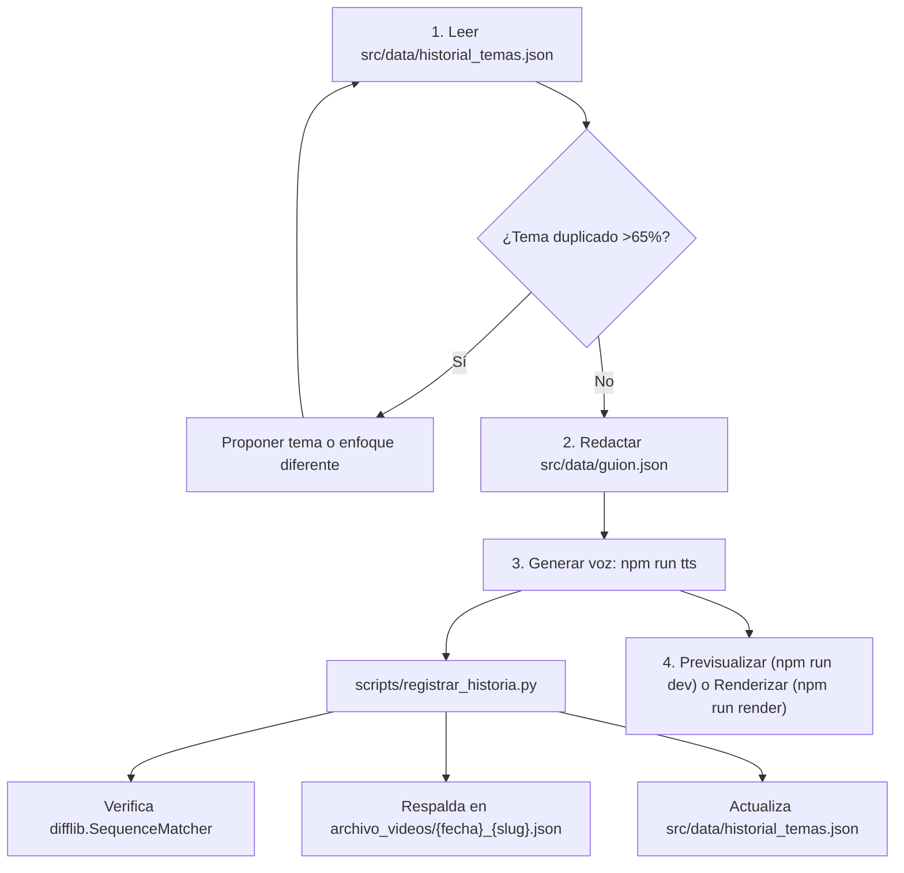

# WORKFLOW.md — Flujo de Trabajo del AutoPNGTuber

## 🚨 REGLA DE ORO ANTES DE CREAR UN GUION

> **REGLA DE ORO ANTES DE CREAR UN GUION**: Siempre que el usuario pida un nuevo video o una idea de historia, el agente DEBE leer primero `src/data/historial_temas.json`, revisar los temas y ganchos existentes, y asegurarse de proponer un tema, enfoque científico o fenómeno completamente distinto a los ya registrados.
>
> ⏱️ **REGLA DE DURACIÓN OBLIGATORIA DEL GUION**:
> - **Mínimo obligatorio forzoso**: El guion DEBE durar **mínimo 1:02 (62 segundos)**.
> - **Rango objetivo**: Entre **1:02** (62s) y **1:30** (90s).
> - **Tope esperado y holgura**: 1:30 es el techo esperado de referencia. Puede pasarse con holgura por no más de 10-20 segundos (máximo ~1:40 a ~1:50). El mínimo de 1:02 es estricto.
>
> 🎨 **CONGRUENCIA, ENFOQUE VISUAL Y ANIMACIÓN DINÁMICA**:
> - Prohibido el contenido visual estático (personaje inmóvil en `{x: 0, y: 0}`).
> - Emplear secuencias de movimiento y físicas (`acciones`: `caminar_hacia`, `sorpresa_y_retroceso`, `tropezar`, desplazamientos).
> - **Cero saturación**: A lo sumo 1 prop en mano cuando corresponda (dejando la otra mano libre para gesticular) y como máximo 1 objeto protagónico en escena (`objetos: [...]`) con física (`flotar`, `caer`, `vibrar` o `pulso`).
> - Priorizar props vectoriales ilustrados (`kidneys`, `black_hole`, `salt_crystal`, `shrinking_cell`, `spaceship`, etc.) sobre stickers circulares genéricos.
> - Activar `elementosNarrativos` (`giant_waves`, `speed_lines`, `danger_vignette`, `shockwave_burst`) y alternar planos de cámara (`primer_plano`, `plano_general`, `shake`, `punch`).

---

## Ciclo de Vida de Producción de un Short

---

## Archivos Clave del Sistema de Historial

- `src/data/historial_temas.json`: Base de datos de temas ya producidos con `id`, `fecha`, `gancho`, `palabrasClave`, `archivoRespaldo` y `textoCompleto`.
- `archivo_videos/`: Carpeta con copias completas de cada `guion.json` generado en la historia del canal.
- `scripts/registrar_historia.py`: Algoritmo de detección de duplicados por similitud y archivador.
- `scripts/generar_voz.py`: Pipeline TTS que actualiza el guion y dispara el registro automático.
